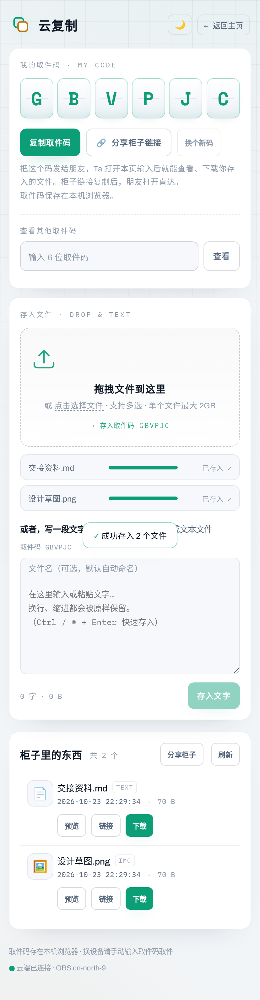
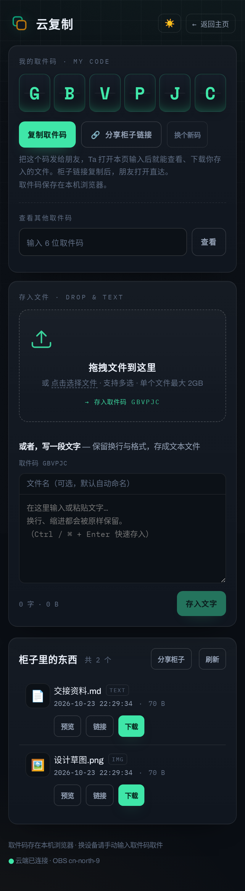

# 云复制 CloudCopy · 取件码文件柜

拖拽文件 / 写一段文字 → 存入华为云 OBS → 用六位取件码随时取回、预览、下载、分享。




## 特性（v2，2026-10-23）

- **浅色主题默认**，右上角 🌙/☀️ 一键切深色（记忆在本机，刷新保持）
- **单文件最大 2GB**：≤64MB 走服务器中转；>64MB 浏览器**直传 OBS**（32MB 分片，不占服务器带宽）
- **柜子分享链接** `?code=XXXXXX`：复制给朋友，打开直达该柜子
- **文件下载链接** `/api/d/{fid}`：单文件永久链接，打开即下载
- 六位大写取件码（A-Z 随机、查重）；可输码查看他人柜子
- 列表：名称/类型/大小/时间 + 预览 + 链接 + 下载
- 预览：文本（服务端转码）、图片/音频/视频/PDF（OBS 签名直读）

## 架构

```
浏览器 ── http://<你的服务器>/cloud-copy/
   │           ├── 静态前端  /var/www/cloud-copy  (nginx :80)
   │           └── /cloud-copy/api/* → nginx 反代 → 127.0.0.1:7012 (FastAPI)
   │                                      │               └── 华为云 OBS
   │                                      └── 大文件：浏览器 ──签名URL──→ OBS 直传
   │                              obs://<your-bucket>/cloud-copy/<CODE>/
```

## 取件码与对象键

- 6 位大写字母，系统生成、自动查重；每码对应 `cloud-copy/<CODE>/` 文件夹
- 对象键：`cloud-copy/<CODE>/<YYYYmmdd-HHMMSS>-<rand4>__<原文件名>`
- 首次进入自动分配「我的取件码」（localStorage）；「换个新码」不迁移旧文件

## 接口

| 方法 | 路径 | 说明 |
|---|---|---|
| GET  | `/api/health` | 健康检查 + 限制信息 |
| GET  | `/api/new_code` | 生成新的六位取件码（查重） |
| POST | `/api/upload_file` | multipart 中转上传（`code` + `file`，≤64MB 推荐） |
| POST | `/api/upload_text` | JSON `{code, filename?, content}`（≤512KB，格式原样） |
| POST | `/api/upload_init` | 直传初始化：小文件返回单个签名 PUT URL；大文件返回分片签名 URL 列表 |
| POST | `/api/upload_complete` | 直传完成登记：分片合并（multipart）+ 返回入库条目 |
| POST | `/api/upload_abort` | 放弃分片上传（清理 OBS 分片） |
| GET  | `/api/list/{code}` | 该码下全部文件（时间倒序） |
| GET  | `/api/file/{code}/{fid}?disposition=inline\|attachment` | 预览/下载（302 → OBS 签名 URL；文本走代理） |
| GET  | `/api/d/{fid}` | **单文件分享链接**（自包含，打开即下载；`?disposition=inline` 可预览） |

## 部署/运维

- 服务：`systemctl {status,restart} cloud-copy`（127.0.0.1:7012，开机自启）
- 前端部署：`bash deploy/deploy.sh`（同步前端 + 重启 + 冒烟）
- CORS（浏览器直传依赖）：`python3 deploy/setup_cors.py`（已配置：PUT/GET/HEAD + ETag）
- nginx：在你的站点配置追加 `deploy/nginx-cloud-copy.conf` 里的 location 块（可按需调整路径）
- 配置：`cp .env.example .env` 填入 OBS 凭据（权限 600）
- 日志：`journalctl -u cloud-copy -f`

## 限制与安全

- 单文件 ≤ 2GB；单条文字 ≤ 512KB；限流：上传 240/h、文字 240/h、列表 720/h、下载 2400/h（按 IP）
- 直传签名 URL 6 小时有效、仅限该对象该分片；CORS 允许所有来源（URL 本身即凭证）
- 文本预览服务端转码（UTF-8/GB18030）且强制 text/plain，防 XSS；SVG 按文本处理
- 预览下载 302 到 OBS 15 分钟签名 URL，不占服务器带宽
- 无删除接口（本版本仅存/看/取/分享）

## 目录

```
cloud-copy/
├── .env                  # OBS 配置（600）
├── backend/main.py       # FastAPI 服务
├── frontend/             # 前端（双主题）+ 自托管字体
├── deploy/               # deploy.sh / systemd / nginx 片段 / setup_cors.py
└── tests/                # smoke.py / ui-check-v2.js / 截图
```

## 变更记录

- **v2 (2026-10-23)**：浅色主题（默认）+ 深色切换；2GB 上传（浏览器直传 + 分片）；柜子分享链接；文件下载链接
- v1 (2026-10-23)：初版（拖拽/文字/取件码/预览/下载/nginx 代理/主页入口）

## 字体

仓库内字体（Archivo / IBM Plex Mono / Space Mono）来自 Google Fonts（@fontsource），SIL OFL 开源许可。
